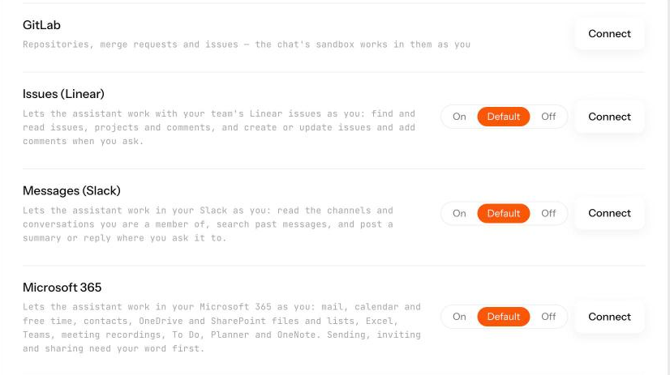
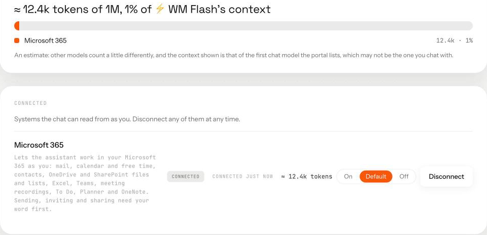

# Microsoft 365 connector for AI agents

`m365-mcp`: free and open source, Apache-2.0.

[](https://github.com/Wide-Moat/microsoft-365-mcp/actions/workflows/validate.yml)
[](LICENSE)

## What it is and why

We tested the MCP servers that exist for Microsoft 365 and built our own. MCP, the Model Context
Protocol, is how an AI agent calls tools. Microsoft 365 is reached through Microsoft Graph, its API.
The existing servers either copy Graph one endpoint at a time or hand the model a generic path to
fetch. Both fill the agent's context and leave it to work out Graph.

We built to two principles:

- **The smallest context for the agent.** 39 tools and about 14,800 tokens of catalogue by default
  (43 tools and about 16,200 tokens with every area on). There is one tool per question a person
  asks, not one per Graph endpoint.
- **Smart tools that carry the logic.** The server does the work Graph leaves to the caller:
  - it resolves names;
  - it expands recurring meetings;
  - it cleans HTML mail both ways;
  - it moves files through signed links that expire in minutes, instead of through the model's context;
  - it refuses what must not happen. Every refusal is written down and has a test that fails when
    its guard is removed.

The server acts as one person, with their own delegated sign-in (the person signs in to their own
Microsoft account and the server uses only that person's rights) and nothing more. We run our own
agents on it every day. The rules every change is held to are in the [manifesto](MANIFESTO.md).

## How it looks

A person connects Microsoft 365 once, with their own work account:



Connected, the whole connector costs the model about 1% of its context window:



## What it does for a person

**Outlook mail.** Finds and reads mail and whole threads, with attachments. Writes a draft as clean
HTML that survives Outlook, and sends it only after you confirm. Moves, flags and deletes mail
(deleted mail goes to Deleted Items). Manages folders and the automatic reply.

**Calendar.** Reads the calendar with recurring meetings expanded. Books, moves and cancels
meetings, answers invitations, and finds times when people and rooms are free. Reads meeting
transcripts and recordings where the administrator allows it.

**OneDrive and SharePoint files.** Searches and reads files, uploads files of up to 250 MB, converts
to PDF, moves, copies and shares them.

**SharePoint lists.** Reads and changes list items as rows.

**Excel.** Reads and writes cells of a workbook in place.

**Teams.** Reads chats and channels. Posts messages, and edits or deletes your own.

**To Do and Planner.** Lists, creates, updates and deletes tasks.

**OneNote.** Lists notebooks and reads, writes and deletes pages.

**Also.** Finds a colleague by part of a name, keeps the address book, reports who you are connected
as and which permissions are missing, and, when switched on, handles Bookings appointments.

Every tool, with its arguments, is in [`docs/tools.md`](docs/tools.md), generated from the code.

## What it will not do

- It never touches inbox rules, forwarding, delegates, permissions, export, or another person's
  mailbox. No tool takes a mailbox argument.
- It never hard-deletes. Deleted mail goes to Deleted Items and deleted files go to the recycle bin.
- Sending is two steps. The model writes a draft, and the server sends only a draft it created
  itself, after the person confirms.
- Every action that notifies other people is limited:
  - at most 20 recipients per message;
  - no distribution lists;
  - a send allowance per person;
  - an optional list of allowed recipient domains.
- Text written by other people comes back marked as data, not instructions. Hidden HTML
  (zero-size, off-screen, same colour as the background) is dropped before the model sees it.
- The token is never logged, echoed or stored. A test reads the logs of a full mail flow and fails
  if any subject, address or body appears in them.

## How it compares

Microsoft ships its own MCP servers for Microsoft 365. It hosts them, prices them with Copilot, and
exposes Graph generically. This server is self-hosted, free, and shaped around the questions a
person asks. The facts below are as Microsoft and each project published them on 1 November 2026.
Every cell has a source below. Corrections are welcome.

| | **m365-mcp** | [Work IQ MCP][workiq] (Microsoft) | [Mail, Calendar, Teams… servers][mail] (Microsoft, Copilot Studio) | [MCP Server for Enterprise][enterprise] (Microsoft) | [Softeria ms-365-mcp-server][softeria] (community) |
|---|---|---|---|---|---|
| Shape | 39 task-shaped tools (43 with every area on) | 12 generic tools that read and write any Graph path | One tool per Graph operation, per workload (Mail: 10) | 3 tools: suggest a query, run a read-only request, list properties | "300+ tools", one per Graph endpoint |
| Scope | One person's mail, calendar, files, lists, Excel, Teams, tasks, notes | Microsoft 365 data, Copilot and agents | One workload each | Entra identity and directory, **read-only** | Most of Graph |
| Status | Used in production | Generally available | Preview, "only intended for backward compatibility" | Preview | Community project |
| Hosting | Self-hosted container, inside your network | Microsoft-hosted endpoint, or a local CLI | Microsoft-hosted | Microsoft-hosted | Self-hosted (npm) |
| Cost | Free, Apache-2.0 | Usage-based, in Copilot Credits | Copilot Studio | No extra cost | Free, MIT |
| Writes | On, each behind its own guard | Blocked by default by tenant policy; an administrator enables them | Direct: a send sends at once | None | On, or `--read-only` |
| Sending mail | Two calls: write a draft, then send it with a confirmation flag the client sets after asking the person; only drafts this server created can be sent; 20 recipients at most, no distribution lists | A generic action on Graph's send endpoint | Sends at once, or sends a saved draft | n/a | Not described |
| Files | Streamed through signed, short-lived links (15 minutes at most); bytes never pass through the model | The whole file as Base64 inside the result, 4 MB by default | Not described | n/a | Single-use download tickets |
| Throttling | Waits as long as Microsoft asks, a bounded number of times | No automatic retries; the client decides | Not described | 100 calls a minute per user | Per-IP rate limit on its HTTP endpoint |
| HTML mail | Cleaned both ways: CSS inlined, active content removed, `data:` images become attachments; hidden text dropped on read | Not described | HTML passed as given | n/a | Body returned as HTML on request |
| Text from other people | Marked as data, not instructions | Not described | Not described | n/a | Not described |

[workiq]: https://learn.microsoft.com/en-us/microsoft-365/copilot/extensibility/work-iq/mcp/overview
[workiq-tools]: https://learn.microsoft.com/en-us/microsoft-365/copilot/extensibility/work-iq/mcp/tool-reference
[workiq-api]: https://learn.microsoft.com/en-us/microsoft-365/copilot/extensibility/work-iq/api-overview#licensing-requirements
[agent365]: https://learn.microsoft.com/en-us/microsoft-agent-365/tooling-servers-overview
[mail]: https://learn.microsoft.com/en-us/microsoft-copilot-studio/mcp-mail-tools
[enterprise]: https://learn.microsoft.com/en-us/graph/mcp-server/overview
[softeria]: https://github.com/Softeria/ms-365-mcp-server

Sources:

- **Work IQ MCP.** The tool list, writes "blocked by default" by tenant policy, file contents as Base64
  with a 4 MB default, and "The server doesn't perform automatic retries" are from the
  [tool reference][workiq-tools]. The design ("Fewer tools, more paths") is from the
  [overview][workiq]. Billing ("usage-based model that uses Copilot Credits") is from the
  [Work IQ API licensing section][workiq-api]. General availability is from the
  [Agent 365 overview][agent365].
- **The workload servers (Mail, Calendar, Teams, …).** The Mail tools, the preview status and "only
  intended for backward compatibility purposes and shouldn't be used in production environments or new
  projects" are from the [Mail reference][mail]; the same note is in the [Agent 365 overview][agent365].
- **MCP Server for Enterprise.** The tools, the read-only scope, "no additional cost", 100 calls a minute
  per user and the preview status are from its [overview][enterprise].
- **Softeria.** "300+ tools", "maps 1-to-1 to a Graph API endpoint", read-only mode, the HTTP rate limit
  and the MIT licence are from its [README][softeria].
- **m365-mcp.** Each limit and refusal in its column is a test in this repository: see
  [How it is tested](#how-it-is-tested) and [`docs/requirements.md`](docs/requirements.md). "Used in
  production" means we run our own agents on it every day.

## How it is tested

Every safety rule has a test, and each test has been seen failing once with its guard removed.

| Check | What it proves | Size |
|---|---|---|
| Unit and contract tests (`pytest`) | Every tool against a recorded fake of Graph: arguments, results, errors, refusals | about 1,700 tests |
| [Refusal map](docs/requirements.md) | Every "must refuse" row names an existing test | 200 refusal tests |
| Refusal evidence (`scripts/refusal_evidence.py`) | Each row's guard is removed in turn and its test must fail | every row |
| Mutation check (`scripts/mutation_check.py`) | Each safety rule is removed in turn and some test must fail | 69 mutations |
| Token budget (`python -m m365_mcp.budget --check`) | The default catalogue stays under 16,000 tokens; every area under 3,500 and every tool under 600 | every pull request |
| Tool surface lock | A changed argument, enum or annotation is visible in review | every pull request |
| Live suite (`pytest -m live`, [how](docs/live-testing.md)) | The same tools against a real Microsoft 365 tenant with two people. It also measures what Microsoft's documentation leaves out ([findings](docs/graph-live-findings.md)) | 37 probes, on demand |
| Secret scan | gitleaks over every commit | every push |
| Purity (`scripts/purity_check.py`) | No real address, Microsoft 365 tenant name or public IP in any tracked file | every push |

## Quick start

```sh
docker run -p 8000:8000 -p 8001:8001 \
  -e M365_LINK_SECRET='<32+ random characters>' \
  -e M365_LINKS_BASE_URL='https://<public address of port 8001>' \
  ghcr.io/wide-moat/microsoft-365-mcp:<version>
```

It needs an Entra app, an administrator's consent and a gateway that signs each person in to Microsoft.
The [setup guide](docs/setup/README.md) walks through all of it, step by step.

## Documents

| Document | What it holds |
|---|---|
| [`docs/setup/README.md`](docs/setup/README.md) | Setup guide |
| [`MANIFESTO.md`](MANIFESTO.md) | The rules, each with what a violation looks like |
| [`docs/requirements.md`](docs/requirements.md) | Contracts and every negative scenario |
| [`docs/architecture.md`](docs/architecture.md) | Components, token path, byte path, threats |
| [`docs/components/`](docs/components) | One document per component |
| [`docs/tools.md`](docs/tools.md) | Every tool and its arguments (generated) |
| [`docs/graph-reference.md`](docs/graph-reference.md) | What Microsoft Graph documents, with sources and unknowns |
| [`docs/graph-live-findings.md`](docs/graph-live-findings.md) | What Graph does on a real tenant (generated) |
| [`docs/live-testing.md`](docs/live-testing.md) | How to run the live suite |
| [`docs/code-review.md`](docs/code-review.md) | What blocks a merge |
| [`CHANGELOG.md`](CHANGELOG.md) | Releases |

## Who made it

[Wide Moat](https://widemoat.ai) runs AI agents for companies on their own infrastructure: chat,
coding workspaces, a model gateway with per-person keys and connectors like this one, all in one
platform on your cluster. This server is one part of it. To get the platform and not only the
connector, write to us through the site.

## Contributing and security

[CONTRIBUTING.md](CONTRIBUTING.md) says how to make and check a change. Report a vulnerability
privately as [SECURITY.md](SECURITY.md) describes, never in a public issue.

## Licence

[Apache-2.0](LICENSE).
