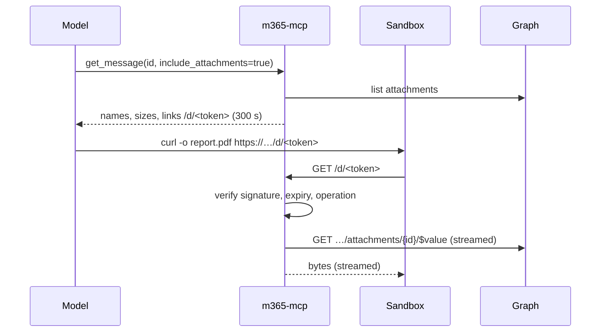

# Architecture

## Context

```mermaid
flowchart LR
  person([Person]) --> chat[Chat / IDE / agent]
  chat -->|MCP, gateway key| gw[MCP gateway]
  gw -->|OAuth per person| entra[(Microsoft Entra ID)]
  gw -->|MCP over HTTP + person's Graph token| srv[m365-mcp]
  srv -->|delegated Graph calls| graph[(Microsoft Graph)]
  sandbox[Agent sandbox] -->|signed links: curl| links[m365-mcp link routes]
  links --> graph
```

- **The gateway** is any MCP gateway that can run a per-person OAuth flow and forward the person's
  access token to an upstream MCP server. It owns the session: it stores and refreshes the tokens.
  This server never sees a refresh token.
- **The Entra application** is one multi-tenant app registration, owned by the vendor. A
  customer's administrator consents to it once for their organisation; after that each person
  signs in to their own account. No customer creates an app registration.
- **m365-mcp** keeps no state beyond the minutes a file link lives. It receives a call carrying a
  bearer token for Graph, does the work, and returns a projection. The open links are held in its
  memory (short ids, below), so it runs as one replica, and a restart loses the open links.
- **The sandbox** is where the agent runs shell commands. It moves bytes (attachments, files,
  recordings, HTML letters) through short-lived signed links, so bytes never pass through the
  model.

## Components

```mermaid
flowchart TB
  subgraph server[m365-mcp]
    mcp[mcp: transport, registry, areas] --> tools
    subgraph tools[tools]
      mail & calendar & files & lists & excel & teams & recordings & tasks & notes & contacts & bookings & account
    end
    tools --> core
    subgraph core[core]
      resolve[resolve: people, folders, sites, time] 
      project[projections]
      html[html pipeline]
      guard[send guard: confirmation + bucket]
      errors[errors]
    end
    tools --> graph[graph client]
    links[links: signed upload/download routes] --> graph
    tools --> links
  end
  graph -->|HTTPS| msgraph[(graph.microsoft.com)]
```

| Component | Responsibility | Document |
|---|---|---|
| `mcp` | Streamable HTTP transport, tool registry, area switches, token budget accounting | [components/mcp.md](components/mcp.md) |
| `identity` | Reads the bearer token from the call, derives who the person is, never stores it | [components/identity.md](components/identity.md) |
| `graph` | The only HTTP client to Graph: immutable ids, time zone, retries, pacing, paging, errors | [components/graph-client.md](components/graph-client.md) |
| `core/resolve` | Names to ids: people, folders, sites, teams, channels, times | [components/resolve.md](components/resolve.md) |
| `core/projections` | Graph objects to the fields a person needs | [components/projections.md](components/projections.md) |
| `core/html` | Outgoing HTML pipeline and incoming HTML-to-text | [components/html.md](components/html.md) |
| `core/guard` | `user_confirmed`, recipient limits, the per-person bucket | [components/guard.md](components/guard.md) |
| `core/errors` | One error type, person-facing text, no content in messages | [components/errors.md](components/errors.md) |
| `links` | Signed download and upload links, streaming both ways | [components/links.md](components/links.md) |
| `tools/*` | One module per area, thin: resolve → graph → project | [components/tools.md](components/tools.md) |
| `observability` | Metrics and logs without content | [components/observability.md](components/observability.md) |

The rule between them: **tools never call HTTP; `graph` never decides policy; `guard` runs before
any call that others will see; `projections` are the only way a Graph object reaches a result.**

## The token path

1. The person presses Connect. The gateway runs the OAuth authorization-code flow with PKCE
   against `login.microsoftonline.com/organizations`, as the vendor's multi-tenant app, asking for
   the scopes of the enabled areas plus `offline_access`.
2. The gateway stores the tokens for that person and refreshes them.
3. On each tool call, the gateway sends `Authorization: Bearer <graph access token>` to this
   server.
4. `identity` validates the token's shape and expiry locally (audience `https://graph.microsoft.com`,
   not expired) and asks Graph `/me` once per token to learn the person; the result is cached in
   memory by token hash until the token expires. A token that Graph rejects is a "reconnect"
   error.
5. Signed links carry the person's identity, but not their token: a link request arrives without
   a bearer. So the link payload carries an **encrypted** copy of the access token (AES-GCM, key
   separate from the signing key), valid only until the link expires, at most 15 minutes and
   never past the token's own expiry. The link the agent receives is a short random id; the signed
   value it stands for waits in the server's memory until the link expires (a signed
   value is ~6,300 characters, and every one cost the model's context). Nothing is written to disk.

## Areas

An area is a set of tools, or of parameters of tools in other areas, plus the scopes they need.
Recordings, for one, is the `include_recording` depth of `get_event`. Areas are switched in configuration
(`M365_AREAS=mail,calendar,files,...`) and, per person, through a header the gateway may forward.
The registry publishes only tools of enabled areas, and `get_connection` reports which areas are
on, which are off, and which lack a granted scope.

| Area | Default | Needs an administrator's consent |
|---|---|---|
| account (always on) | on | no |
| mail | on | no |
| calendar and scheduling | on | rooms only |
| contacts | on | no |
| files (OneDrive, SharePoint libraries) | on | no |
| lists (SharePoint lists) | on | no |
| excel | on | no |
| teams | on | channel reading |
| recordings (meeting video and transcripts) | on | yes |
| tasks (To Do, Planner) | on | no |
| notes (OneNote) | on | no |
| bookings | **off** | yes |

## Moving bytes



Uploads mirror it: a tool returns `/u/<token>` links, the sandbox `curl -T`s the file, the server
streams it to Graph (single request below the size threshold, an upload session above it).

The MCP endpoint is reachable only from the gateway. The link routes are the one part reachable
from sandboxes, because sandboxes reach the outside only through public HTTPS; they accept nothing
but a valid signed link.

## Threats and what stops them

| Threat | Stop |
|---|---|
| A prompt injection asks to forward mail, add a rule, share a folder publicly | Those operations do not exist |
| An injection asks to send something | Draft first, `user_confirmed`, the bucket, recipient caps, the allowed recipient domains when set. `user_confirmed` is a boolean the model sets: it records that the model says the person agreed, and the server cannot check that they did. A model that follows the injection can set it, so what bounds the damage is structural: only a draft the person can see in Outlook is sent, at most 20 recipients, no lists, 10 sends at once, and only the allowed domains when the installation sets them. A client that shows each confirmed call to the person before it runs is what turns the flag into their word |
| An injection asks to read someone else's mailbox | No mailbox argument; Graph enforces the person's rights |
| A leaked signed link | Expires in minutes, bound to one object, one operation, one person |
| A leaked log | No content, no addresses, no tokens in logs |
| A compromised gateway | Holds tokens already; this server adds no new secret except the link keys |
| A compromised server pod | Sees tokens in flight, and the sealed copies behind open links (minutes; memory only, never disk) |
| Throttling by Graph | Client paces below limits; honours `Retry-After`; tells the person how long to wait |
| A large file exhausting memory | Streaming with spooled temp files; bounded chunk sizes |

## Deployment

- One container image, a non-root user, read-only root file system; `/tmp` as an `emptyDir` for
  spooled uploads.
- Configuration by environment: enabled areas, link signing and encryption keys (from a secret
  store), the public base URL for links, limits.
- Readiness checks its own configuration (keys present, base URL set); liveness is a plain
  endpoint. Neither calls Graph.
- Network: ingress to the MCP port from the gateway only; ingress to the link routes from the
  public route; egress to `graph.microsoft.com:443` and the SharePoint/OneDrive download hosts
  that Graph redirects to (`*.sharepoint.com`).
